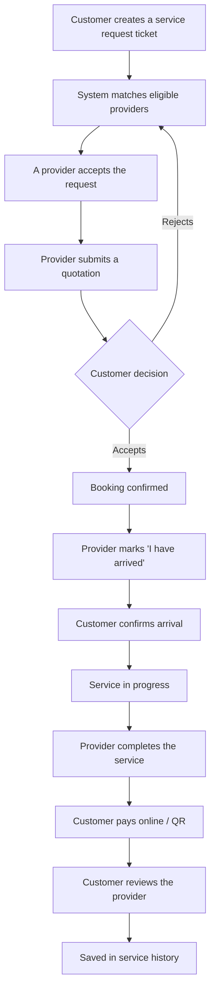

# GharKaaj – Local Service Booking and Management Platform

A web-based platform where customers request local household services (electrician, plumber, appliance repair, etc.), suitable verified providers accept and quote, and the whole job – booking, arrival, service, **post-service payment**, review and history – is managed in one place.

> **Second Year Project (SYP)** · BSc (Hons) Computing · Itahari International College
> **Student:** Krish Shah · **Supervisor:** Binu Rai · **Pathway:** Entrepreneurship

---

## Project status

| Item | Status |
|---|---|
| Proposal | ✅ Submitted and approved |
| Database design (ERD + SQL schema) | ✅ Done |
| Authentication (register, login, JWT, role-based access, 3 dashboards) | ✅ Done and tested |
| Wireframes (6 core screens: customer, provider, admin) | ✅ Done |
| Remaining application development (Phase 1 onwards) | ⏳ Not started yet |

This README is updated as each phase is completed.

---

## The problem

When something breaks at home (a fan, a refrigerator, a pipe), most people do not know whom to call, whether the technician is genuine, whether they work in the area, or what it will cost. People depend on neighbours, relatives, phone contacts and social media, which gives no structure, no agreed price and no accountability.

## The solution

GharKaaj turns this into one clear digital workflow:



**Payment happens only after the service is completed**, never when the provider arrives.

---

## User roles

| Role | What they can do |
|---|---|
| **Customer** | Register/login, browse services, create requests, view and accept/reject quotations, confirm provider arrival, pay after service, review the provider, view service history |
| **Service Provider** | Register/login, manage profile, skills, service area and availability, receive matching requests, accept/decline, submit quotations, mark arrival, complete service, view job history and ratings |
| **Administrator** | Manage users, verify/approve providers, manage categories and services, monitor requests, bookings and payments, manage reviews, view statistics, suspend users |

---

## MVP features

- Registration, login and **role-based access** (Customer / Provider / Admin)
- Service category and service management (admin)
- Provider profiles, skills, service areas, availability and admin verification
- **Manual service request (ticket) creation** and request management
- Provider matching: service/skill + verified + available + service area (+ workload)
- Provider accept/decline, **quotation**, customer quotation confirmation
- Booking creation and booking status management
- Provider arrival + customer arrival confirmation (stored with timestamps)
- Service completion
- **Post-service payment** (online/QR-style; eSewa/Khalti sandbox or a simulated flow)
- Review and rating, customer service history, provider job history
- Dashboards for each role, basic search and filtering, in-app notifications

### Optional enhancements (only after the MVP is stable)

AI-assisted request creation · exact GPS distance · OTP arrival verification · advanced/real-time notifications · multiple-provider bidding · wallet/escrow · mobile app · multi-city expansion.

AI, OTP and GPS are **not** required for the core system to work.

---

## Technology stack

| Layer | Technology |
|---|---|
| Frontend | React (Vite), React Router, plain CSS |
| Backend | Node.js, Express.js (REST API) |
| Database | MySQL (`mysql2` driver) |
| Authentication | JWT (`jsonwebtoken`) + password hashing (`bcryptjs`) |
| Payment | eSewa / Khalti sandbox, or simulated payment flow |
| Tools | Git, GitHub, VS Code, Terminal |

---

## Booking and request status flow

```
Request:  OPEN → ACCEPTED → QUOTE_SUBMITTED → BOOKED            (or CANCELLED)
Booking:  BOOKED → ARRIVED → IN_PROGRESS → SERVICE_COMPLETED
                 → PAYMENT_PENDING → PAID → REVIEWED            (or CANCELLED)
```

Invalid status jumps are blocked by backend logic. Full details are in [`docs/database-design.md`](docs/database-design.md).

---

## Database

- **ERD:** [`docs/erd/gharkaaj_erd.png`](docs/erd/gharkaaj_erd.png) (editable source: `gharkaaj_erd.dot`, vector: `gharkaaj_erd.svg`)
- **Design explanation and business rules:** [`docs/database-design.md`](docs/database-design.md)
- **SQL schema:** [`database/schema.sql`](database/schema.sql) · **Seed data:** [`database/seed.sql`](database/seed.sql)

18 tables cover users and roles, profiles, service catalogue, provider skills/areas/availability, requests, quotations, bookings, payments, reviews, notifications and an audit trail (`service_events`).

---

## Run the project locally

Requires Node.js 18+ and MySQL 8.0+.

**1. Create the database**

```bash
mysql -u root -p < database/schema.sql
mysql -u root -p < database/seed.sql
```

**2. Set up the backend**

```bash
cd Backend
npm install
```

Copy `.env.example` to `.env` and fill in your MySQL password and a long random `JWT_SECRET`. The `.env` file is ignored by Git and must never be committed.

**3. Create the first admin account** (admins cannot register from the website)

```bash
npm run create-admin
```

**4. Start the backend** (runs on port 3000)

```bash
npm start
```

**5. Start the frontend** (open a second terminal)

```bash
cd Frontend
npm install
npm run dev
```

Open `http://localhost:5173`. The frontend sends all `/api` requests to the backend automatically (see `Frontend/vite.config.js`), so both terminals must stay running.

---

## Repository structure

```
GharKaaj/
├── Backend/
│   ├── config/db.js                  # MySQL connection pool
│   ├── controllers/authController.js # register, login, my profile
│   ├── middleware/authMiddleware.js  # verifyToken, allowRoles
│   ├── routes/authRoutes.js
│   ├── scripts/createAdmin.js        # creates the first admin
│   ├── server.js
│   ├── package.json
│   └── .env.example
├── Frontend/                         # React app (Vite)
│   ├── index.html
│   ├── vite.config.js
│   ├── package.json
│   └── src/
│       ├── Assets/ (images, videos)
│       ├── CSS/    (style, index, authForm, dashboard)
│       ├── Pages/  (Index, Login, Register, Customer/Provider/AdminDashboard)
│       ├── Components/ (Navbar, Footer, ProtectedRoute, DashboardBase)
│       ├── JS/     (auth.js helper functions)
│       ├── App.jsx (routes)
│       └── main.jsx
├── database/
│   ├── schema.sql
│   └── seed.sql
├── docs/
│   ├── database-design.md
│   └── erd/
└── README.md
```

## API (authentication)

| Method | Route | Access | Purpose |
|---|---|---|---|
| POST | `/api/auth/register` | Public | Register as CUSTOMER or PROVIDER |
| POST | `/api/auth/login` | Public | Login, returns a JWT |
| GET | `/api/auth/me` | Logged-in users | Profile of the current user |

---

## Development plan

- [x] **Phase 0 – Planning:** proposal, database design
- [ ] **Phase 1 – Core application:** ~~authentication, roles~~ (done), services, provider profiles, manual ticket creation
- [ ] **Phase 2 – Matching:** skill/service matching, provider verification, availability, service-area matching
- [ ] **Phase 3 – Quotation and booking:** provider acceptance, quotation, customer confirmation, booking lifecycle
- [ ] **Phase 4 – Service and payment:** arrival confirmation, service completion, payment flow and records
- [ ] **Phase 5 – Review and history:** ratings, reviews, service history
- [ ] **Phase 6 – Optional enhancements:** AI-assisted requests, GPS distance, OTP, advanced notifications

The system must be fully usable before Phase 6.

---

## Security

**Implemented and tested**
- Passwords stored only as bcrypt hashes
- JWT login; every protected request also re-checks that the user is still ACTIVE (suspended users lose access immediately)
- Role-based access middleware (`allowRoles`); admin accounts cannot be created through registration
- Backend validation of all registration and login input (the frontend validation is only for convenience)
- Same error message for wrong email and wrong password
- Secrets kept in `.env`, which is not committed

**Known limitations / not yet done**
- The JWT is kept in the browser's `localStorage`, which is simple but can be read by injected scripts if the site ever has an XSS bug
- No login rate limiting and no HTTPS in the local setup

The project does not claim any security certification or compliance.

---

## Notes

- This is an academic prototype. Payments use a sandbox or simulated flow, and no real money is handled.
- Local service booking platforms already exist in Nepal (for example Sajilo Sewa). GharKaaj focuses on a more complete workflow: structured request tickets, quotation confirmation, arrival confirmation, post-service payment, reviews and service history.

## Author

**Krish Shah** – BSc (Hons) Computing, Itahari International College
Supervisor: **Binu Rai**
