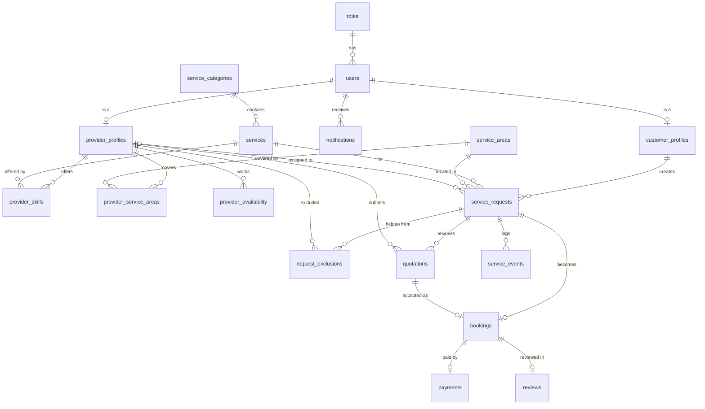

# GharKaaj – Database Design

This document explains the database behind the GharKaaj MVP. The full SQL is in [`database/schema.sql`](../database/schema.sql) and the detailed diagram is [`docs/erd/gharkaaj_erd.png`](erd/gharkaaj_erd.png).

## 1. Why MySQL?

The project proposal allowed MongoDB or MySQL. MySQL was chosen because the project's most important rules are *relational* rules:

- one request can become only **one** booking
- one booking has only **one** payment and **one** review
- a request can be claimed by only **one** provider
- a payment must always belong to a real booking

A relational database can enforce these with keys, `UNIQUE` constraints and foreign keys, so the rules do not depend only on frontend code.

## 2. Overview diagram

The full ERD (all columns) is in `docs/erd/gharkaaj_erd.png`. This simplified version shows only the relationships and renders directly on GitHub.



## 3. Tables at a glance (18)

| Group | Table | Purpose |
|---|---|---|
| Access | `roles` | CUSTOMER, PROVIDER, ADMIN |
| | `users` | Login account for every role (email, bcrypt hash, status) |
| | `customer_profiles` | Customer details (1:1 with a user) |
| | `provider_profiles` | Provider details, verification status, workload limit (1:1 with a user) |
| | `service_areas` | List of cities/areas used for service-area matching |
| Catalogue | `service_categories` | e.g. Appliance Repair |
| | `services` | e.g. Refrigerator Repair (sub-service) |
| | `provider_skills` | Which provider offers which service (many-to-many) |
| | `provider_service_areas` | Which provider covers which area (many-to-many) |
| | `provider_availability` | Weekly working hours of a provider |
| Workflow | `service_requests` | The ticket created by the customer |
| | `request_exclusions` | Providers who declined, or whose quote was rejected, so they do not see the request again |
| | `quotations` | Price submitted by the provider before the service |
| | `bookings` | Confirmed job created when a quotation is accepted |
| | `service_events` | Audit trail (who did what and when) |
| Money / feedback | `payments` | Post-service payment record (one per booking) |
| | `reviews` | Rating and comment (one per booking) |
| | `notifications` | In-app status messages |

**Not a table: Service History.** Service history is a *query* joining `bookings`, `payments` and `reviews`. Storing it separately would duplicate data.

## 4. Status lifecycle

Your lifecycle (REQUESTED → … → REVIEWED) is split across two tables, because the *request* exists before the *booking*.

```
service_requests.status
OPEN ──► ACCEPTED ──► QUOTE_SUBMITTED ──► BOOKED
  ▲            │               │
  └────────────┴───────────────┘   (provider declines / customer rejects quote → request reopens)
Any state before BOOKED ──► CANCELLED

bookings.status
BOOKED ──► ARRIVED ──► IN_PROGRESS ──► SERVICE_COMPLETED ──► PAYMENT_PENDING ──► PAID ──► REVIEWED
Any state before IN_PROGRESS ──► CANCELLED
```

| Your original state | Where it lives now |
|---|---|
| REQUESTED | `service_requests.status = OPEN` |
| ACCEPTED | `service_requests.status = ACCEPTED` |
| QUOTE_SUBMITTED | `service_requests.status = QUOTE_SUBMITTED` |
| CUSTOMER_CONFIRMED + BOOKED | One step: the customer accepts the quote, a `bookings` row is created, request becomes `BOOKED` |
| ARRIVED → REVIEWED | `bookings.status` |

Arrival is recorded in two timestamps: `arrived_at` (provider pressed *I've Arrived*) and `arrival_confirmed_at` (customer pressed *Confirm Arrival*). Only after the second one does the booking move to `IN_PROGRESS`.

`SERVICE_COMPLETED` and `PAYMENT_PENDING` happen in the same database transaction: completing the service creates the `payments` row with status `PENDING` and moves the booking to `PAYMENT_PENDING`.

## 5. Business rules and where they are enforced

| Rule | Enforced by |
|---|---|
| Only one provider can claim a request | Backend atomic `UPDATE ... WHERE status='OPEN'` (see 6.1) |
| One booking per request / per quotation | `UNIQUE` on `bookings.request_id` and `bookings.quotation_id` |
| A provider quotes a request only once | `UNIQUE (request_id, provider_id)` on `quotations` |
| One payment per booking | `UNIQUE` on `payments.booking_id` |
| One review per booking | `UNIQUE` on `reviews.booking_id` |
| Rating 1–5, amount > 0, end time after start time | `CHECK` constraints |
| Unique email per user | `UNIQUE` on `users.email` |
| Payment happens after the service | Backend creates the payment row only when the service is completed |
| Review only after payment | Backend checks `payments.status = 'PAID'` |
| No invalid status jumps | Backend state-transition check (see 6.3) |
| Users only reach their own role's actions | Backend JWT + role middleware |

## 6. Key backend patterns

### 6.1 Atomic provider claim (prevents two providers taking the same job)

```sql
UPDATE service_requests
SET status = 'ACCEPTED', assigned_provider_id = ?, accepted_at = NOW()
WHERE request_id = ? AND status = 'OPEN';
```

In Node.js, check `result.affectedRows`:

- `1` → this provider won the request
- `0` → someone else was faster; return "Request is no longer available"

Because the check and the update are one SQL statement, two providers clicking at the same moment cannot both succeed.

### 6.2 Provider matching (service/skill + verification + availability + area + workload)

```sql
SELECT r.*
FROM service_requests r
JOIN provider_profiles p ON p.provider_id = ?          -- the logged-in provider
JOIN users u ON u.user_id = p.user_id
WHERE r.status = 'OPEN'
  AND u.status = 'ACTIVE'
  AND p.verification_status = 'APPROVED'
  AND p.is_accepting_requests = TRUE
  AND EXISTS (SELECT 1 FROM provider_skills ps
              WHERE ps.provider_id = p.provider_id AND ps.service_id = r.service_id)
  AND EXISTS (SELECT 1 FROM provider_service_areas pa
              WHERE pa.provider_id = p.provider_id AND pa.area_id = r.area_id)
  AND EXISTS (SELECT 1 FROM provider_availability a
              WHERE a.provider_id = p.provider_id
                AND a.day_of_week = DAYOFWEEK(r.preferred_date) - 1   -- 0 = Sunday
                AND a.start_time <= r.preferred_start_time
                AND a.end_time   >= r.preferred_end_time)
  AND NOT EXISTS (SELECT 1 FROM request_exclusions x
                  WHERE x.request_id = r.request_id AND x.provider_id = p.provider_id)
  AND (SELECT COUNT(*) FROM bookings b
       WHERE b.provider_id = p.provider_id
         AND b.status IN ('BOOKED','ARRIVED','IN_PROGRESS')) < p.max_active_jobs
ORDER BY r.priority DESC, r.created_at ASC;     -- URGENT first, then oldest
```

The matching is a *pull* model: a provider opening "New Requests" sees only the requests that match them. No notification system is needed for the MVP.

### 6.3 Status transition check (backend)

```js
const allowedBookingTransitions = {
  BOOKED:            ['ARRIVED', 'CANCELLED'],
  ARRIVED:           ['IN_PROGRESS', 'CANCELLED'],
  IN_PROGRESS:       ['SERVICE_COMPLETED'],
  SERVICE_COMPLETED: ['PAYMENT_PENDING'],
  PAYMENT_PENDING:   ['PAID'],
  PAID:              ['REVIEWED'],
};
// before updating: if (!allowedBookingTransitions[current]?.includes(next)) -> reject with 400
```

## 7. Design decisions worth explaining in your viva

1. **Request vs Booking are separate tables.** The request is the customer's problem. The booking is the agreed job with a provider, date and price.
2. **`agreed_amount` is copied into `bookings`.** If the quotation row is ever edited, the agreed price of a booking does not change.
3. **`payments` has no customer/provider columns.** They are reached through `booking_id`. Storing them again would duplicate data and could become inconsistent.
4. **`request_exclusions` exists** so a provider who declined, or whose quote was rejected, does not keep seeing the same request.
5. **`service_events` is the audit trail.** It is the database-backed proof of events such as *provider arrived* and *customer confirmed arrival*.
6. **Admin accounts are not seeded in SQL**, because passwords must be hashed by the backend.

## 8. What is deliberately NOT in the database (Phase 6 / future)

OTP records, GPS latitude/longitude, wallet, escrow, bids, refund history, complaints and AI logs are not modelled. Adding GPS later is a small change, for example:

```sql
ALTER TABLE service_requests ADD latitude DECIMAL(9,6) NULL, ADD longitude DECIMAL(9,6) NULL;
```

## 9. Open decisions to confirm with your supervisor

1. **Customer rejects a quotation:** current design = quotation `REJECTED`, provider added to `request_exclusions`, request returns to `OPEN`.
2. **Customer never confirms arrival:** the booking would be stuck in `ARRIVED`. Options: allow an admin to override, or auto-confirm after a set time. Not decided.
3. **Payment retry:** the design keeps one payment row per booking, so a failed payment is updated and retried (attempts are logged in `service_events`).
